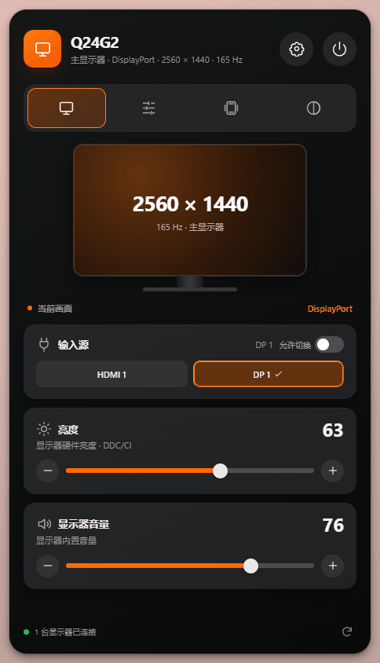
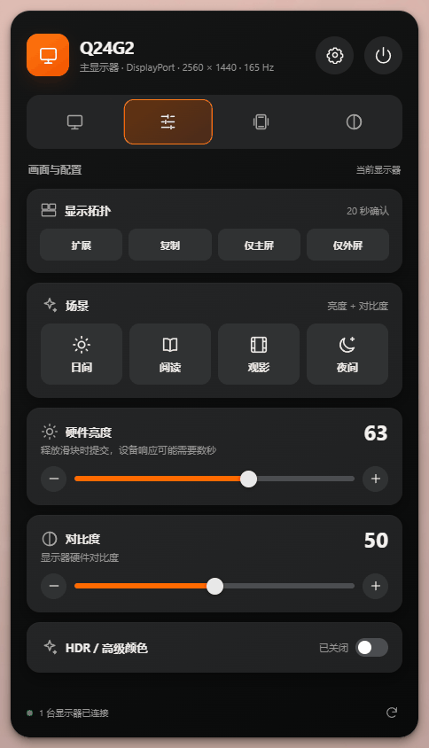
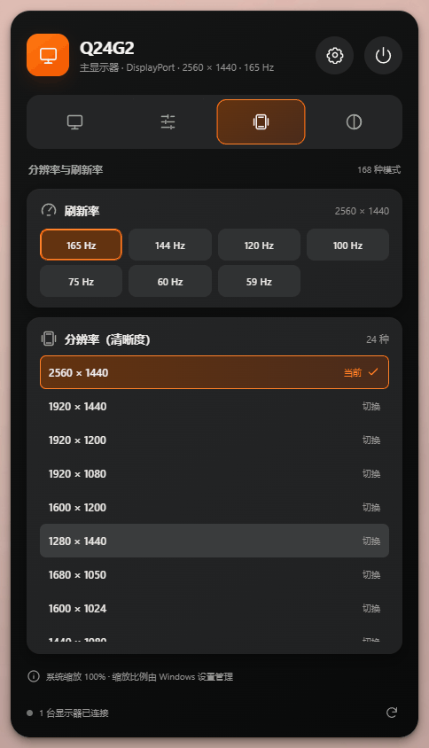
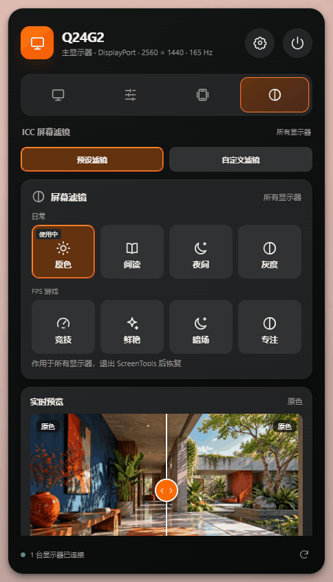
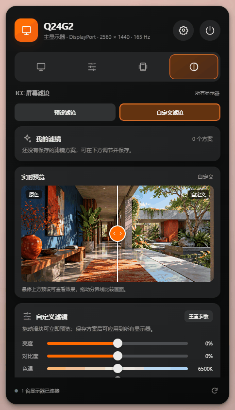
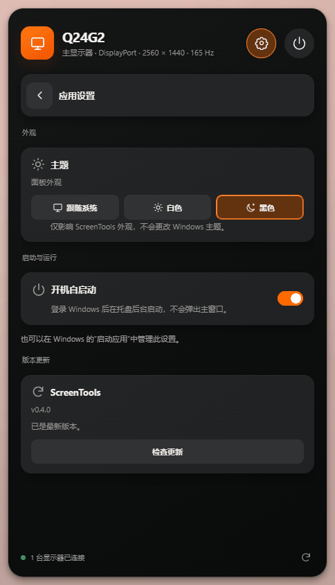

<h1 align="center">
  
  <br />
  ScreenTools
</h1>

<p align="center"><strong>你的显示器，一眼掌握。</strong></p>

<p align="center">
  在 Windows 托盘中查看显示状态、调整画面与硬件参数、切换刷新率与分辨率。<br />
  基于 Win32 CCD 与 DDC/CI，所有控制都留在本机，不依赖云服务。
</p>

<p align="center">
  <a href="LICENSE"></a>
  <a href="#平台支持"></a>
  <a href="#技术栈"></a>
</p>

<p align="center">
  <a href="https://github.com/yosong-github/ScreenTools/releases/latest">下载 Windows 安装包</a> ·
  <a href="https://yosong-github.github.io/ScreenTools/">在线官网</a> ·
  <a href="https://yosong-github.github.io/ScreenTools/features.html">功能预览</a> ·
  <a href="https://yosong-github.github.io/ScreenTools/guide/getting-started.html">快速开始</a> ·
  <a href="https://yosong-github.github.io/ScreenTools/guide/screen-filters.html">屏幕滤镜说明</a> ·
  <a href="CHANGELOG.md">更新日志</a> ·
  <a href="https://github.com/yosong-github/ScreenTools/releases">版本发布</a> ·
  <a href="https://github.com/yosong-github/ScreenTools/issues">问题反馈</a>
</p>

---

## 下载与安装

前往 [最新版本发布页](https://github.com/yosong-github/ScreenTools/releases/latest)，在 **Assets** 中下载 `ScreenTools-版本号-win-x64.exe` 并运行。需要旧版本时，请查看[全部版本](https://github.com/yosong-github/ScreenTools/releases)。`Source code` 压缩包是源码，不是安装程序。

目前仅提供 **Windows x64** 安装包，未配置发布者签名。应用会检查本仓库的最新 GitHub Release；发现新版本时，设置图标会显示红点，安装包会在应用内自动下载，等待用户在“应用设置 → 版本更新”确认安装。下载时核对安装包大小；GitHub 提供 SHA-256 摘要时也会核对摘要。如果新版安装包尚未上传，可稍后重试或打开发布页。首次安装可能出现 Windows 安全提示，请核对下载地址是否为本仓库的 GitHub Release。新版本的 Release 页面可能先于 EXE 出现；如果 Assets 中暂时只有源码包，请等待 Windows 构建完成后刷新页面。

## 简介

ScreenTools 是一个面向 **Windows x64** 的本机显示器管理工具。它以托盘面板为主界面，没有常驻主窗口。底部四个图标页分别查看设备、调整画面、切换显示模式；标题栏的齿轮进入应用设置。

- 通过 **Win32 CCD** 读取并切换显示拓扑、分辨率与刷新率；
- 通过 **DDC/CI** 读取并写入显示器硬件亮度、对比度、音量与输入源；
- **屏幕滤镜**是后加的一项：用 Windows 全屏颜色矩阵改变整个桌面的颜色，不安装 ICC 文件，也不改硬件参数；
- 所有数据与设置保存在本机，不经过任何云端服务。

对于会中断画面的系统级配置（如显示拓扑、分辨率、刷新率、HDR），应用会在提交后要求 **20 秒内确认**，否则尝试恢复原有配置。

## 功能

| 页面               | 能力                                                                                                                                                                                                                                                                                                   |
| ------------------ | ------------------------------------------------------------------------------------------------------------------------------------------------------------------------------------------------------------------------------------------------------------------------------------------------------ |
| 屏幕信息           | 分辨率、刷新率、主屏状态与连接方式。输入源默认只展示，打开「允许切换」并确认后才能改。支持时调节硬件亮度与显示器音量                                                                                                                                                                                   |
| 画面配置           | 页内标题是「画面与配置」。扩展 / 复制 / 仅主屏 / 仅外屏，日间、阅读、观影、夜间场景，硬件亮度、对比度；显示器支持时显示 HDR / 高级颜色                                                                                                                                                                 |
| 刷新率与清晰度     | 页内标题是「分辨率与刷新率」。只列出这台显示器上报的刷新率与分辨率，系统缩放仍由 Windows 管理                                                                                                                                                                                                          |
| 屏幕滤镜（新功能） | 页内标题是「ICC 屏幕滤镜」，作用于所有显示器。预设分日常（原色、阅读、夜间、灰度）和 FPS 游戏（竞技、鲜艳、暗场、专注）；自定义滤镜可调亮度、对比度、色温等并保存方案。悬停只预览，点击才生效，退出后恢复。说明见[屏幕滤镜指南](https://yosong-github.github.io/ScreenTools/guide/screen-filters.html) |
| 应用设置           | 从标题栏齿轮进入，不是第五个标签。主题为跟随系统、白色、黑色；安装版可开关开机自启动；版本更新检查 GitHub Release，下载后需确认才安装                                                                                                                                                                  |

默认全局快捷键 `Ctrl+Alt+D` 只打开托盘面板，不直接切换功能。安装版默认开机自启动，可在应用设置或 Windows「启动应用」中关闭。

> 硬件亮度、对比度、音量、输入源和 HDR 是否可用，取决于显示器与驱动是否支持对应命令。调节硬件参数前，请先在显示器菜单中开启 **DDC/CI**。

## 界面

<p align="center">
  
  
  
</p>
<p align="center">
  
  
  
</p>

## 平台支持

仅支持 **Windows x64**。系统显示配置使用 Win32 CCD，显示器硬件控制使用 DDC/CI；具体能力取决于设备与驱动。

## 技术栈

- **运行时**：Electron、Vue 3、Pinia
- **原生调用**：Koffi（Node-API FFI），在独立进程内调用 Windows API
- **构建与语言**：TypeScript、Vite、electron-vite、UnoCSS
- **工程质量**：ESLint、Prettier、Vitest、Husky、lint-staged、Commitlint
- **官网**：VitePress
- **包管理**：pnpm workspace

## 项目结构

```text
ScreenTools/
├─ apps/
│  ├─ desktop/          # Electron 桌面应用（main / preload / renderer）
│  └─ website/          # VitePress 官网
├─ packages/
│  ├─ contracts/        # 共享 TypeScript 契约与 IPC 通道定义
│  ├─ display-core/     # 与平台无关的显示逻辑
│  ├─ display-control/  # DisplayControlService 接口与编排
│  └─ display-native/   # Koffi 绑定的 Windows CCD / DDC/CI 实现
└─ .github/workflows/    # 打包与官网部署工作流
```

桌面应用的主进程运行在 Node 侧，通过独立的 `native-worker` 进程加载 Koffi 调用 Win32 API；渲染进程仅通过 preload 暴露的类型化接口访问能力，不直接接触原生调用。

## 开发

**环境要求**：Node.js ≥ 24、pnpm ≥ 11。

```bash
pnpm install   # 安装依赖
pnpm dev       # 启动桌面应用（electron-vite）
```

官网位于 `apps/website`，使用 VitePress：

```bash
pnpm --filter @screentools/website dev
pnpm --filter @screentools/website build
```

官网通过 GitHub Pages 发布。首次使用时，在仓库 **Settings → Pages → Build and deployment → Source** 选择 **GitHub Actions**；此后将官网或其依赖配置的修改推送到 `main`，`Deploy Website` 工作流会自动构建并部署到 <https://yosong-github.github.io/ScreenTools/>，也可以在 Actions 页面手动运行。站点使用 `/ScreenTools/` 作为路径前缀。

## 本地打包

```bash
pnpm build:unpack # release/win-unpacked
pnpm build:win    # Windows x64 NSIS 安装包
```

当前仍是硬件测试版本。开发版与安装版数据隔离，设置和方案写入 Electron `userData` 下的 `control.json`，最近 200 条操作写入 `operations.json`。安装向导完成页可勾选是否立即启动；开机启动仅支持安装版，全新安装默认开启。

模式写入、多屏热插拔、扩展坞、HDR 与硬件电源控制仍需按文档进行实机验收。独立进程回滚不等于绝对黑屏保护：驱动挂起、系统崩溃或工作进程被强杀可能阻止恢复；软件会报告未确认状态，必要时请使用 Windows 显示设置恢复。

## GitHub Actions 手动打包

1. 将工作流推送 / 合并到 GitHub 仓库默认分支。
2. 打开 **Actions → Package Desktop → Run workflow**，选择分支并运行 Windows x64 打包。
3. 成功后在该次运行的 **Artifacts** 下载 EXE，保留 14 天。

手动构建会先执行 lint、格式检查、类型检查、测试和生产构建，再打包；失败不会上传安装包。工作流不创建 GitHub Release、不自动发布、不需要额外的签名 Secrets。

参考：[GitHub 手动运行工作流](https://docs.github.com/en/actions/how-tos/manage-workflow-runs/manually-run-a-workflow)。

## 质量检查

```bash
pnpm check   # lint + 格式检查 + 类型检查 + 测试 + 生产构建
```

提交信息使用 [Conventional Commits](https://www.conventionalcommits.org/) 格式，例如：

```text
feat: add display overview shell
fix: close the window safely
docs: update architecture notes
```

## 版本与发布

版本号与更新日志由 [release-please](https://github.com/googleapis/release-please) 依据 Conventional Commits 自动维护，无需手动改动版本号或编写 changelog。

发布流程：

1. 改动合并到 `main` 后，`Release Please` 工作流会自动创建 / 更新一个 `chore(main): release x.y.z` 的 PR，其中包含版本号提升与根目录 `CHANGELOG.md` 更新（`feat` 提升次版本，`fix` 提升补丁版本）。
2. 需要发布时合并该 PR；release-please 会打上 `vX.Y.Z` 标签并创建 GitHub Release。
3. 同一工作流随后调用 `Release Build`，在 Windows x64 上构建 EXE 并上传到对应的 Release 资产。Release 创建和安装包上传并非同时完成，请在构建结束后下载。也可以手动运行 `Release Build` 重建某个版本：标签留空表示使用最新 Release，填写时须是形如 `v0.2.0` 的完整标签。

版本号以 `apps/desktop/package.json` 为准（electron-builder 读取该值）。下载请使用[最新版本发布页](https://github.com/yosong-github/ScreenTools/releases/latest)。

> 首次使用前，请在仓库 **Settings → Actions → General → Workflow permissions** 选择 **Read and write permissions**，并勾选 **Allow GitHub Actions to create and approve pull requests**，release-please 才能创建 release PR 与 Release。

## 安全提醒

- 切换输入源或关闭显示器可能使当前画面断开，请仅在确认可以使用显示器实体按键恢复时操作。
- 独立进程回滚不能替代 Windows 显示设置或显示器实体按键，驱动挂起、系统崩溃或进程被强杀都可能阻止自动恢复。
- 复制模式下无法唯一匹配物理设备时，请先切换到扩展模式。

## 贡献

欢迎提交 Issue 与 Pull Request。参与开发前请先运行 `pnpm check` 并通过全部检查，并遵循 Conventional Commits 提交规范。

## 许可证

本项目基于 [MIT License](LICENSE) 开源。
